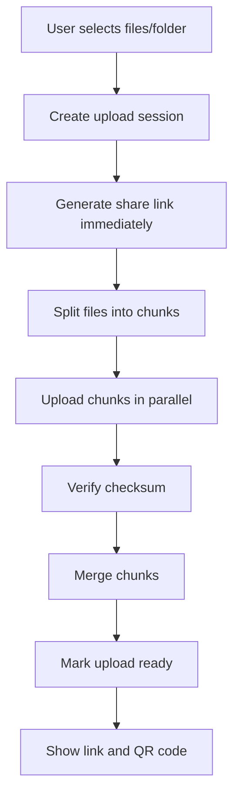
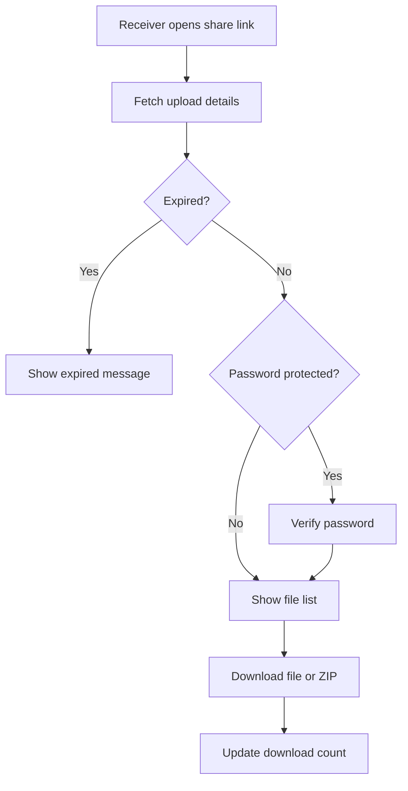

# AGENTS.md — Dark Theme Fast File Sharing Website

## Project Goal

Create a modern file-sharing website inspired by Fileport-style workflows. The website must allow users to upload files/folders quickly and share them using a public link and QR code. The default UI must be a night/dark theme with a day/night theme toggle.

> Reference functionality observed from Fileport: instant downloads while upload is in progress, drag-and-drop file/folder upload, upload links, email sharing, password-protected downloads, download statistics, folder batching/compression, checksum validation, automatic region selection, upload resumption, guest uploads, account uploads, and secure encrypted storage.

---

## Tech Stack

### Frontend

- HTML5
- CSS3
- JavaScript ES6+
- Optional: Vite for development build
- Optional libraries:
  - `qrcode` or `QRCode.js` for QR generation
  - `JSZip` for ZIP download/folder compression
  - `CryptoJS` or Web Crypto API for checksums
  - `tus-js-client` for resumable upload

### Backend

- Node.js
- Express.js
- Multer / Busboy for file streaming
- Optional: tus-node-server for resumable uploads
- JWT/session auth for users
- bcrypt for password hashing

### Database

- PostgreSQL for production

### Storage

- Local storage for MVP
- AWS S3 / Cloudflare R2 / MinIO for production

---

## Core Functionality Analysis

### 1. File Upload

Implement:

- Drag and drop upload area
- Click to select files
- Folder upload support using `webkitdirectory`
- Multiple file upload
- Auto upload after selection
- Upload progress percentage
- Upload speed display
- Estimated time remaining
- Pause upload
- Resume upload
- Cancel upload
- Retry failed upload
- Chunk upload for large files
- Parallel chunk upload for faster transfer
- Checksum verification for uploaded chunks
- Auto merge chunks on server

### 2. Fast File Sharing

Implement:

- Chunk-based upload
- Resume interrupted uploads
- Parallel uploads
- Small file batching
- Folder ZIP creation option
- Streaming-like availability: generate share link immediately after upload starts
- Upload status on receiver page: uploading, ready, failed, expired

### 3. Share by Link

After upload starts or completes:

- Generate unique share ID
- Create public share URL: `/download/{shareId}`
- Copy link button
- Native Web Share API button
- WhatsApp share button
- Email share button/form
- Regenerate link option

### 4. Share by QR Code

Implement:

- Generate QR code from share URL
- Show QR code in modal
- Download QR as PNG
- Copy QR image option
- Print QR option
- QR code should work on mobile devices

### 5. Download Page

Route:

```txt
/download/:shareId
```

Download page must show:

- File/folder title
- Total file size
- Number of files
- Upload date
- Expiry date
- Download count
- File list with icons
- Download single file
- Download all as ZIP
- Password input if protected
- Expired link message
- Download limit reached message
- Upload still in progress message

### 6. Security Features

Implement:

- Secret/random share IDs
- Password-protected downloads
- Password hashing using bcrypt
- Link expiry: 1 hour, 1 day, 7 days, 30 days, never
- Download limit setting
- Private/public toggle
- File type validation
- Max file size validation
- Virus scan placeholder hook
- HTTPS required in production
- Signed storage URLs for production
- Rate limiting
- Abuse report link

### 7. User Dashboard

Dashboard pages:

- Login
- Register
- My uploads
- Upload details
- Account settings

Dashboard functionality:

- View all uploads
- Search uploads
- Filter active/expired
- Sort by date, size, downloads
- Copy share link
- View QR code
- Edit expiry
- Add/remove password
- Delete upload
- Rename upload
- View download statistics

---

## Layout and Theme Requirements

### Default Theme

- Night/dark theme must be default.
- Add day/night toggle in top navbar.
- Save selected theme in `localStorage`.

### Design Style

- Modern SaaS layout
- Glassmorphism upload card
- Gradient accent buttons
- Rounded corners
- Smooth hover effects
- Mobile-first responsive design
- Clean dashboard cards
- Minimal distractions

### Color Tokens

```css
:root {
  --bg: #050816;
  --bg-soft: #0b1020;
  --card: #111827;
  --card-soft: #1f2937;
  --text: #f9fafb;
  --muted: #9ca3af;
  --border: #263244;
  --primary: #6366f1;
  --primary-2: #06b6d4;
  --success: #22c55e;
  --danger: #ef4444;
  --warning: #f59e0b;
}

[data-theme="light"] {
  --bg: #f8fafc;
  --bg-soft: #eef2ff;
  --card: #ffffff;
  --card-soft: #f1f5f9;
  --text: #0f172a;
  --muted: #64748b;
  --border: #dbe3ef;
  --primary: #4f46e5;
  --primary-2: #0891b2;
}
```

---

## Required Pages

### 1. Home Page — `index.html`

Sections:

- Navbar
- Hero section
- Upload card
- Feature cards
- How it works
- Security section
- Pricing teaser
- Footer

Hero text:

```txt
Fast & Secure File Sharing
Upload files and share instantly using a link or QR code.
```

Upload card must include:

- Drag and drop area
- Select files button
- Select folder button
- Upload progress
- Speed and remaining time
- Share link area
- QR code button

### 2. Download Page — `download.html`

Features:

- Read share ID from URL
- Fetch upload details
- Show file list
- Password verification
- Download buttons
- QR/link section
- Expiry/download-limit checks

### 3. Dashboard Page — `dashboard.html`

Features:

- Upload list
- Search and filters
- Stats cards
- Upload action menu

### 4. Login/Register Page — `auth.html`

Features:

- Login form
- Register form
- Forgot password placeholder
- Google/Apple login placeholder optional

---

## Suggested Folder Structure

```txt
file-share-app/
├── public/
│   ├── index.html
│   ├── download.html
│   ├── dashboard.html
│   ├── auth.html
│   └── assets/
│       ├── icons/
│       └── images/
├── src/
│   ├── css/
│   │   ├── style.css
│   │   ├── theme.css
│   │   └── responsive.css
│   ├── js/
│   │   ├── app.js
│   │   ├── uploader.js
│   │   ├── download.js
│   │   ├── dashboard.js
│   │   ├── qr.js
│   │   ├── theme.js
│   │   └── api.js
│   └── components/
│       ├── navbar.js
│       ├── upload-card.js
│       ├── file-list.js
│       └── toast.js
├── server/
│   ├── app.js
│   ├── routes/
│   │   ├── upload.routes.js
│   │   ├── download.routes.js
│   │   └── auth.routes.js
│   ├── controllers/
│   │   ├── upload.controller.js
│   │   └── download.controller.js
│   ├── middleware/
│   │   ├── auth.js
│   │   ├── rate-limit.js
│   │   └── error-handler.js
│   ├── models/
│   │   ├── user.model.js
│   │   ├── upload.model.js
│   │   └── file.model.js
│   ├── services/
│   │   ├── storage.service.js
│   │   ├── zip.service.js
│   │   ├── qr.service.js
│   │   └── checksum.service.js
│   └── uploads/
├── package.json
├── .env.example
└── README.md
```

---

## API Requirements

### Upload APIs

```txt
POST /api/uploads/init
POST /api/uploads/chunk
POST /api/uploads/complete
GET  /api/uploads/:uploadId
DELETE /api/uploads/:uploadId
```

### Download APIs

```txt
GET  /api/download/:shareId
POST /api/download/:shareId/verify-password
GET  /api/download/:shareId/file/:fileId
GET  /api/download/:shareId/zip
```

### Dashboard APIs

```txt
GET /api/dashboard/uploads
PATCH /api/dashboard/uploads/:uploadId
DELETE /api/dashboard/uploads/:uploadId
```

### Auth APIs

```txt
POST /api/auth/register
POST /api/auth/login
POST /api/auth/logout
GET  /api/auth/me
```

---

## Database Schema

### User

```js
{
  id: String,
  name: String,
  email: String,
  passwordHash: String,
  createdAt: Date,
  updatedAt: Date
}
```

### Upload

```js
{
  id: String,
  userId: String | null,
  shareId: String,
  title: String,
  totalSize: Number,
  totalFiles: Number,
  status: "uploading" | "ready" | "failed" | "expired",
  passwordHash: String | null,
  expiryDate: Date | null,
  downloadLimit: Number | null,
  downloadCount: Number,
  isPublic: Boolean,
  allowZipDownload: Boolean,
  createdAt: Date,
  updatedAt: Date
}
```

### File

```js
{
  id: String,
  uploadId: String,
  originalName: String,
  storedName: String,
  mimeType: String,
  size: Number,
  path: String,
  checksum: String,
  chunkCount: Number,
  uploadedChunks: Number,
  status: "uploading" | "ready" | "failed",
  createdAt: Date
}
```

---

## Frontend JavaScript Logic

### Upload Flow



### Download Flow



---

## UI Components

### Navbar

- Logo
- Upload link
- Dashboard link
- Pricing link placeholder
- Login button
- Theme toggle

### Upload Card

- Drag/drop zone
- File/folder buttons
- Upload queue
- Progress bars
- Share result section

### Share Result

- Share link input
- Copy button
- QR button
- WhatsApp button
- Email button

### QR Modal

- QR code canvas/image
- Download QR button
- Close button

### Toast Notification

- Success
- Error
- Warning
- Info

---

## CSS Requirements

Use modern CSS:

- CSS variables
- Flexbox
- CSS Grid
- Responsive breakpoints
- Smooth transitions
- Dark/light theme using `data-theme`
- Accessible focus states

Example theme toggle logic:

```js
const root = document.documentElement;
const savedTheme = localStorage.getItem("theme") || "dark";
root.setAttribute("data-theme", savedTheme);

function toggleTheme() {
  const current = root.getAttribute("data-theme");
  const next = current === "dark" ? "light" : "dark";
  root.setAttribute("data-theme", next);
  localStorage.setItem("theme", next);
}
```

---

## Minimum MVP Scope

Build first:

1. Dark homepage
2. Drag/drop upload
3. File upload to backend
4. Generate share link
5. Generate QR code
6. Download page
7. Download file
8. Day/night theme toggle

Then add:

1. Chunk upload
2. Resume upload
3. Password protection
4. Expiry date
5. Dashboard
6. Download stats
7. ZIP download

---

## Acceptance Criteria

The project is complete when:

- User can upload one or multiple files.
- User gets a share link after upload starts/completes.
- User can generate and download a QR code.
- Receiver can open link and download files.
- Website uses dark theme by default.
- Day/night toggle works and persists.
- Layout is responsive on mobile and desktop.
- Upload progress, speed, and status are visible.
- Expired/password-protected links are handled correctly.
- Code is separated into clean HTML, CSS, JS, and backend modules.

---

## Agent Instructions

You are an expert full-stack developer. Implement this project step by step.

Rules:

- Keep code clean and modular.
- Do not put all logic in one file.
- Use semantic HTML.
- Use accessible buttons and labels.
- Use CSS variables for themes.
- Use modern JavaScript modules.
- Add comments only where useful.
- Handle errors gracefully.
- Never expose storage paths directly.
- Validate all inputs on frontend and backend.
- Make the UI look premium and modern.

Final output should include:

- Complete folder structure
- Working frontend files
- Working backend files
- README with setup commands
- `.env.example`
- Screenshots or UI preview notes
