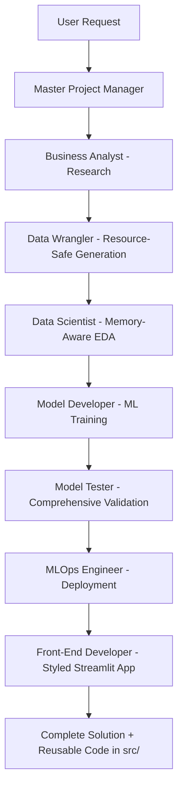

# Domino Data Lab Claude Code Agents

## Overview

This collection of Claude Code agents provides comprehensive support for building end-to-end machine learning demonstrations on the Domino Data Lab platform. Each agent specializes in a specific aspect of the ML lifecycle, and they work together to create production-ready solutions with governance compliance, resource-safe execution, and automated code reusability.

All agents are powered by **Claude Sonnet 4.5** (`claude-sonnet-4-5-20250929`) for optimal performance and capabilities.

## Agent Roles & Responsibilities

### Core Orchestration
- **Master-Project-Manager-Agent** (purple): Orchestrates all other agents, manages workflows, coordinates governance compliance, extracts reusable code to `/mnt/code/src/{project}/`, and ensures project success across the entire ML lifecycle

### Data & Analysis
- **Data-Wrangler-Agent** (red): Finds or generates data with resource management (50MB limit, 12GB RAM monitoring), manages data quality, creates data pipelines, saves to `/mnt/data/{DOMINO_PROJECT_NAME}/`, and extracts data processing utilities to `/mnt/code/src/{project}/`
- **Data-Scientist-Agent** (blue): Performs exploratory data analysis with memory limits, creates visualizations, generates insights, identifies potential bias, and extracts feature engineering utilities to `/mnt/code/src/{project}/`

### Model Development & Validation
- **Model-Developer-Agent** (orange): Develops, trains, and optimizes ML models using various frameworks with comprehensive MLflow tracking, and extracts model utilities to `/mnt/code/src/{project}/`
- **Model-Tester-Agent** (purple): Comprehensively tests ML models including functional validation, performance testing, edge cases, compliance verification, and extracts testing utilities to `/mnt/code/src/{project}/`

### Requirements & Deployment
- **Business-Analyst-Agent** (green): Translates business needs into technical requirements, defines success metrics, assesses regulatory compliance, and identifies applicable governance frameworks
- **MLOps-Engineer-Agent** (yellow): Creates deployment pipelines, monitoring, production infrastructure, CI/CD, and extracts deployment/monitoring/serving utilities to `/mnt/code/src/{project}/`
- **Front-End-Developer-Agent** (cyan): Builds Streamlit applications with standardized styling (muted professional theme), Semantic UI integration, performance optimizations, and responsive layouts

### Documentation
- **Agent-Interaction-Protocol**: Reference for how agents communicate with each other
- **Example-Demonstration-Flows**: Sample workflows showing file organization and MLflow integration

## New Features

### 🆕 Resource Management (Prevents Workspace Crashes)
- **50MB File Size Limit**: All data files automatically limited to prevent disk issues
- **12GB RAM Monitoring**: Continuous memory monitoring with psutil during data generation
- **Chunked Processing**: 10K rows per chunk to prevent memory spikes
- **Automatic Sampling**: Reduces data when limits exceeded
- **Real-time Progress**: "Generated X/Y rows (Memory: Z GB)"

### 🆕 Directory Validation
- **Automatic validation** of `/mnt/data/{DOMINO_PROJECT_NAME}/`
- **User prompts** if directory doesn't exist with options:
  - Type `create` to auto-create directory
  - Enter custom path if different location needed
- **No silent failures** - agents won't proceed without valid directory

### 🆕 Code Extraction to `/mnt/code/src/`
All agents extract reusable code at epoch completion:
- **Epoch 002**: `data_processing_utils.py`, `data_loading_pipeline.py`
- **Epoch 003**: `feature_engineering.py`
- **Epoch 004**: `model_utils.py`
- **Epoch 005**: `validation.py`
- **Epoch 006**: `deployment.py`, `monitoring.py`, `serving.py`
- Proper Python package structure with `__init__.py` and `README.md`

### 🆕 Streamlit Styling Standards
- **Professional muted theme**: #BAD2DE, #CBE2DA, #E5F0EC
- **Semantic UI integration**: Consistent card components
- **Wide layout**: Full-width responsive design
- **Performance caching**: `@st.experimental_singleton`, `@st.experimental_memo`
- **3-column grids**: Responsive KPI displays
- **Custom components**: Styled cards, formatting utilities

## Typical Workflow



## File Organization

All agents follow a standardized directory structure:

```
/mnt/
├── code/
│   ├── src/{project}/                    # Reusable code extracted here
│   │   ├── __init__.py
│   │   ├── data_processing_utils.py
│   │   ├── data_loading_pipeline.py
│   │   ├── feature_engineering.py
│   │   ├── model_utils.py
│   │   ├── validation.py
│   │   ├── deployment.py
│   │   ├── monitoring.py
│   │   ├── serving.py
│   │   └── README.md
│   ├── epoch001-research-analysis-planning/
│   ├── epoch002-data-wrangling/         # Uses existing directories
│   ├── epoch003-data-exploration/
│   ├── epoch004-model-development/
│   ├── epoch005-model-testing/
│   ├── epoch006-application-development/
│   └── epoch007-retrospective/
│       └── app/                         # Streamlit apps with styling
│           ├── app.py
│           └── style.css
├── artifacts/
│   └── epoch00X-xxx/                    # Models, reports, visualizations
└── data/{DOMINO_PROJECT_NAME}/          # Project-specific data
    ├── epoch002-data-wrangling/
    │   └── synthetic_data.parquet       # Max 50MB
    ├── epoch003-data-exploration/
    └── epoch004-model-development/
```

## Getting Started

### Basic Usage

1. **Simple Model Development with Resource Safety**:
   - Start with Data-Wrangler-Agent to acquire data (memory-safe)
   - Use Data-Scientist-Agent for EDA (with size limits)
   - Deploy Model-Developer-Agent for training

2. **Full Pipeline with Code Extraction**:
   - Use Master-Project-Manager-Agent
   - It will orchestrate all agents automatically
   - Reusable code extracted to `/mnt/code/src/{project}/`

### Example Commands

```python
# For a quick demo with resource management
"Create a credit risk model demo with synthetic data"
# → Generates max 50MB data with 12GB RAM limit

# For comprehensive pipeline
"Build an end-to-end customer churn prediction system with Streamlit dashboard"
# → Creates styled app with professional theme

# For specific tasks
"Generate synthetic financial data for fraud detection"
# → Chunked generation with memory monitoring

"Perform EDA on this dataset and create visualizations"
# → Resource-aware analysis with sampling if needed

"Deploy this model with monitoring"
# → Extracts deployment utilities to src/
```

## Key Features

### MLflow Integration
- All agents log experiments, metrics, and artifacts to MLflow
- Parent-child run hierarchy for complex workflows
- Model registry with signatures and input examples
- Comprehensive tracking of all pipeline stages
- Resource usage metrics logged (memory, file sizes)

### Governance & Compliance
- **Business Analyst Agent** conducts preliminary research including regulatory assessment
- Identifies applicable frameworks: NIST RMF, Model Risk Management V3, Ethical AI
- Assesses industry-specific regulations (SOX, HIPAA, GDPR, etc.)
- **Model Tester Agent** validates compliance with all identified frameworks
- Integrated approval workflows with defined approver groups
- Comprehensive audit trails and documentation

### Technology Stack
- **Primary Language**: Python 3.8+ for all ML operations
- **ML Frameworks**: scikit-learn, XGBoost, LightGBM, TensorFlow, PyTorch
- **UI Framework**: Streamlit with standardized styling
- **Deployment**: FastAPI, Flask, Docker, Domino Flows
- **Model Tracking**: MLflow for experiment tracking and model registry
- **Resource Monitoring**: psutil for memory management

### Error Handling
- Graceful degradation with fallback strategies
- Comprehensive logging and monitoring
- **Resource limit warnings** before failures
- Clear error messages and remediation steps
- **Directory validation** prevents silent failures

## Output Standards

Each agent produces:
- Python notebooks with documentation
- Production-ready Python scripts
- Requirements.txt for dependencies
- MLflow experiments with full tracking
- **Reusable utilities in `/mnt/code/src/{project}/`**
- Comprehensive documentation with usage examples

## Resource Management Best Practices

### Data Generation
```python
# Automatic handling:
- Chunked generation (10K rows/chunk)
- Memory monitoring before each chunk
- Garbage collection between chunks
- Progress: "Generated 50000/100000 rows (Memory: 8.5 GB)"
- Automatic sampling if 50MB exceeded
```

### File Size Limits
```python
# Automatic enforcement:
- All data files limited to 50MB
- Parquet with Snappy compression
- Size verification after save
- Error if limit exceeded
```

### Directory Validation
```python
# Automatic prompts:
Expected directory: /mnt/data/{DOMINO_PROJECT_NAME}/
Enter 'create' or provide path: _
```

## Streamlit App Standards

### Standard Style.css
```css
/* Muted Professional Theme */
.table-bg { background-color: #BAD2DE !important; }
.view-bg { background-color: #CBE2DA !important; }
.mv-bg { background-color: #E5F0EC !important; }
.muted-text { color: rgb(90, 90, 90); }
```

### App Structure
```python
# Wide layout with caching
st.set_page_config(layout="wide")
@st.experimental_singleton
def load_model(): ...

# 3-column KPIs
col1, col2, col3 = st.columns(3)

# Custom cards with styling
create_card(title, content, bg_class="view-bg")
```

## Best Practices

1. **Always specify project name** for proper organization
2. **Monitor resource usage** through logged metrics
3. **Use extracted code** from `/mnt/code/src/{project}/` in subsequent projects
4. **Validate directories** before starting data operations
5. **Test with small datasets first** to verify resource limits
6. **Identify governance requirements early** in project planning
7. **Use standardized Streamlit styling** for consistent UX

## Tips for Sales Engineers

- Start with the Master-Project-Manager-Agent for complete demos with resource safety
- Highlight **50MB/12GB limits** to show workspace crash prevention
- Demonstrate **reusable code extraction** to `/mnt/code/src/` for productivity
- Show **Streamlit styling standards** for professional-looking demos
- Use **directory validation** to show robustness
- Leverage Model-Tester-Agent to showcase comprehensive validation
- Highlight governance compliance features for regulated industries

## Code Reusability Example

```python
# Import extracted utilities from previous epochs
import sys
sys.path.insert(0, '/mnt/code/src')

from myproject.data_loading_pipeline import load_and_prepare_data
from myproject.data_processing_utils import *
from myproject.feature_engineering import *
from myproject.model_utils import *

# Use in new projects
df = load_and_prepare_data(project_name='myproject')
features = engineer_features(df)
model = train_model(features, target)
```

## Dependencies

Core Python packages required:
- pandas, numpy, scikit-learn
- mlflow, optuna, joblib
- streamlit (for apps)
- fastapi, flask
- xgboost, lightgbm
- plotly, seaborn, matplotlib
- psutil (for memory monitoring)

## Additional Resources

- Review `Agent-Interaction-Protocol.md` for communication patterns
- Check `Example-Demonstration-Flows-With-File-Structure.md` for workflow examples
- Governance policies located in `/mnt/code/.reference/governance/`
- Approver groups defined in `/mnt/code/.reference/governance/Approvers.md`
- Each agent file contains detailed system prompts and key methods
- Streamlit styling guide: https://github.com/mydgd/snowflake-table-catalog

## Agent Versions

Current model: **Claude Sonnet 4.5** (`claude-sonnet-4-5-20250929`)

All agents were updated to use the latest Claude Sonnet 4.5 model for enhanced reasoning, coding capabilities, and performance.

## Change Log

### Latest Updates
- ✅ All agents now use existing epoch directories (no new directory creation)
- ✅ Data saved to `/mnt/data/{DOMINO_PROJECT_NAME}/` with validation
- ✅ 50MB file size limits with automatic enforcement
- ✅ 12GB RAM monitoring to prevent workspace crashes
- ✅ Chunked data generation (10K rows/chunk)
- ✅ Reusable code extraction to `/mnt/code/src/{project}/`
- ✅ Streamlit apps with professional muted theme
- ✅ Semantic UI integration for styling
- ✅ Performance caching and session state management
- ✅ All agents have full tool access (Read, Write, Edit, Bash)
